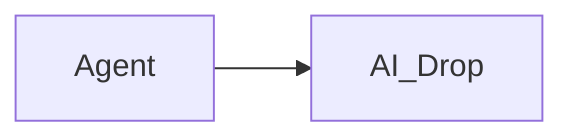
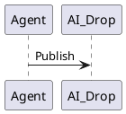

# AI Drop

**A lightweight, self-hosted publishing service for AI agents and tools.**

Publish HTML, Markdown, and ZIP websites under stable project URLs. Browse
published work without logging in; protect publishing and management with one
bearer token.

## What you can publish

| Format | Preview |
| --- | --- |
| HTML | Sandboxed page with Home and project navigation |
| Markdown | Sanitized document with selectable/copyable source and browser-rendered Mermaid and PlantUML diagrams |
| ZIP website | Validated static site with relative assets and nested pages |

Use the REST API or the Streamable HTTP MCP endpoint. Both share the same
storage and project/artifact operations.

## Quick start

Requires Docker Compose and a published [GitHub release image](https://github.com/nsenica/aidrop/releases). From the repository directory:

```sh
export AIDROP_BEARER_TOKEN="$(openssl rand -hex 32)"
docker compose --file compose.ghcr.yaml up -d
```

Open [http://127.0.0.1:6420](http://127.0.0.1:6420). Compose stores published
artifacts in the persistent `aidrop-data` volume and binds to host loopback by
default.

The image defaults to `ghcr.io/nsenica/aidrop:latest`. To pin a release, set
`AIDROP_VERSION` to its version without the `v` prefix, such as `1.2.3`. See
the [container deployment guide](docs/REFERENCE.md#container-deployment) for
release and package visibility details.

### Build from source

To build the image locally instead, run:

```sh
docker compose up --build -d
```

Publish a Markdown note:

```sh
curl -fsS \
  -H "Authorization: Bearer $AIDROP_BEARER_TOKEN" \
  -H 'Content-Type: text/markdown' \
  --data-binary '# Hello from AI Drop' \
  http://127.0.0.1:6420/api/v1/projects/demo/artifacts/notes
```

The response includes a stable public URL for the new artifact.

Markdown previews render Mermaid flowcharts, sequence diagrams, and class
diagrams from fenced blocks. PlantUML class and sequence diagrams are also
supported. For example:





The Mermaid renderer is bundled with AI Drop, so previews do not load diagram
scripts from external services. The vendored Tiny bundle is already minified;
when the browser advertises gzip support, its JavaScript transfer is about
755 KB (738 KiB), while clients without gzip receive the same valid JavaScript
uncompressed.

PlantUML uses the official, MIT-licensed browser engine from the pinned
`@plantuml/core@1.2026.9` package. AIDrop serves its renderer assets locally,
so PlantUML previews work without a third-party CDN or an internet connection.
Diagram source stays in the browser and is never sent to a rendering service.
The vendored TeaVM and Graphviz runtime files are already minified/precompiled;
gzip transfer for the two main files is about 1.12 MB for the PlantUML engine
and 601 KB for `viz-global` (about 1.64 MiB together). A Markdown page creates
one sandboxed renderer frame and initializes those assets once;
multiple diagrams are rendered through that frame in sequence. Remote
PlantUML includes are blocked. If rendering fails, the original fenced source
remains visible.

## Security

Public previews and `/healthz` are unauthenticated. The bearer token protects
REST management routes under `/api/v1` and MCP at `/mcp`. Keep it private; do
not place it in browser code or URLs. For remote access, use a TLS-terminating
reverse proxy, set exact browser Origins with `AIDROP_ALLOWED_ORIGINS`, and
keep the management API protected.

## Documentation

See the [API, MCP, deployment, limits, reverse proxy, and backup guide](docs/REFERENCE.md).
