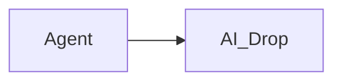

# AI Drop

**A lightweight, self-hosted publishing service for AI agents and tools.**

Publish HTML, Markdown, and ZIP websites under stable project URLs. Browse
published work without logging in; protect publishing and management with one
bearer token.

## What you can publish

| Format | Preview |
| --- | --- |
| HTML | Sandboxed page with Home and project navigation |
| Markdown | Sanitized document with selectable/copyable source and local Mermaid diagrams |
| ZIP website | Validated static site with relative assets and nested pages |

Use the REST API or the Streamable HTTP MCP endpoint. Both share the same
storage and project/artifact operations.

## Quick start

Requires Docker Compose. From the repository directory:

```sh
export AIDROP_BEARER_TOKEN="$(openssl rand -hex 32)"
docker compose up --build -d
```

Open [http://127.0.0.1:6420](http://127.0.0.1:6420). Compose stores published
artifacts in the persistent `aidrop-data` volume and binds to host loopback by
default.

Publish a Markdown note:

```sh
curl -fsS \
  -H "Authorization: Bearer $AIDROP_BEARER_TOKEN" \
  -H 'Content-Type: text/markdown' \
  --data-binary '# Hello from AI Drop' \
  http://127.0.0.1:6420/api/v1/projects/demo/artifacts/notes
```

The response includes a stable public URL for the new artifact.

Markdown previews render Mermaid flowcharts, sequence diagrams, and class
diagrams from fenced blocks. For example:



The Mermaid renderer is bundled with AI Drop, so previews do not load diagram
scripts from external services.

## Security

Public previews and `/healthz` are unauthenticated. The bearer token protects
REST management routes under `/api/v1` and MCP at `/mcp`. Keep it private; do
not place it in browser code or URLs. For remote access, use a TLS-terminating
reverse proxy, set exact browser Origins with `AIDROP_ALLOWED_ORIGINS`, and
keep the management API protected.

## Documentation

See the [API, MCP, deployment, limits, reverse proxy, and backup guide](docs/REFERENCE.md).
