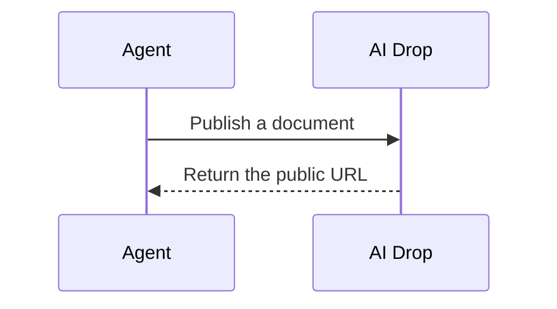
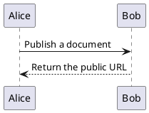

# AI Drop Technical Reference

[Back to the project overview](../README.md).

AI Drop is a single Go HTTP service for publishing project artifacts. The server starts with a public health endpoint and a bearer-token-protected management API namespace.

## Run the empty server

Install Go 1.25 or newer, set the required management token, then start the service:

```sh
export AIDROP_BEARER_TOKEN='choose-a-secret-value'
go run ./cmd/aidrop
```

The server listens on `127.0.0.1:6420` by default and stores data under `./data`.
`GET /healthz` is public. Management routes under `/api/v1` require the token in
the `Authorization: Bearer …` header.

## Configuration

| Environment variable | Required | Default | Purpose |
| --- | --- | --- | --- |
| `AIDROP_BEARER_TOKEN` | Yes | — | Bearer token for management requests |
| `AIDROP_LISTEN_ADDR` | No | `127.0.0.1:6420` | HTTP listen address |
| `AIDROP_DATA_DIR` | No | `./data` | Persistent data directory |
| `AIDROP_ALLOWED_ORIGINS` | No | — | Comma-separated exact browser Origins allowed for MCP and REST CORS |

## Standalone HTML API

Management requests use `Authorization: Bearer $AIDROP_BEARER_TOKEN` and raw
`text/html` bodies. HTML bodies must be non-empty and no larger than 5 MiB.

| Request | Success | Behavior |
| --- | --- | --- |
| `POST /api/v1/projects/{project}/artifacts/{artifact}` | `201 Created` | Create an artifact and return metadata with its stable public URL |
| `PUT /api/v1/projects/{project}/artifacts/{artifact}` | `200 OK` | Replace an existing artifact at the same public URL |
| `GET /api/v1/projects/{project}/artifacts/{artifact}` | `200 OK` | Return artifact metadata |
| `GET /api/v1/projects/{project}/artifacts/{artifact}/source` | `200 OK` | Return the exact stored source bytes |
| `DELETE /api/v1/projects/{project}/artifacts/{artifact}` | `204 No Content` | Delete the artifact |

Open the returned URL at `/p/{project}/{artifact}/` without authentication.
The preview includes navigation back to the project and home pages, while the
uploaded document runs inside a sandboxed frame. The frame response uses
`Content-Security-Policy: sandbox allow-scripts` without `allow-same-origin`;
the authenticated source endpoint continues to return the exact uploaded bytes.
Public artifact previews and files served from ZIP sites send
`Cache-Control: no-store`, `X-Robots-Tag: noindex, nofollow`, and
`Referrer-Policy: no-referrer` on successful GET and HEAD responses. The cache
policy helps avoid stale previews after updates. The other headers discourage
indexing and referrer disclosure; artifact URLs remain public and the headers
do not provide access control.

Errors use a JSON object with `code` and `message` fields. Duplicate POSTs
return `409 conflict`; a missing PUT, GET, or DELETE returns `404 not_found`.
Other common codes are `400 invalid_slug`, `400 empty_payload`,
`401 unauthorized`, `413 payload_too_large`, and `415 unsupported_media_type`.

### REST agent workflow

With the service running, an agent can publish, update, list, retrieve, and
delete an HTML artifact with these authenticated requests:

```sh
export AIDROP_BEARER_TOKEN='choose-a-secret-value'
base_url='http://127.0.0.1:6420'
printf '%s\n' '<h1>First version</h1>' > page.html

curl -fsS -H "Authorization: Bearer $AIDROP_BEARER_TOKEN" \
  -H 'Content-Type: text/html' --data-binary @page.html \
  "$base_url/api/v1/projects/demo/artifacts/homepage"
curl -fsS -X PUT -H "Authorization: Bearer $AIDROP_BEARER_TOKEN" \
  -H 'Content-Type: text/html' --data-binary @page.html \
  "$base_url/api/v1/projects/demo/artifacts/homepage"
curl -fsS -H "Authorization: Bearer $AIDROP_BEARER_TOKEN" \
  "$base_url/api/v1/projects/demo/artifacts"
curl -fsS "$base_url/p/demo/homepage/"
curl -fsS -H "Authorization: Bearer $AIDROP_BEARER_TOKEN" \
  -X DELETE "$base_url/api/v1/projects/demo/artifacts/homepage"
```

Replace `demo` and `homepage` with lowercase kebab-case slugs. The public view
is unauthenticated; management and source routes require the bearer token.

### Sharing published artifact URLs

The REST metadata `url` field and MCP publishing tools' `url` field contain a
path such as `/p/demo/homepage/`, relative to the configured AIDrop server
address. A receiving agent should use the AIDrop base URL configured for its
integration and resolve the path into an absolute URL; it should not infer the
server address from the artifact.

```js
const aidropBaseURL = "https://aidrop.example"; // configured for this integration
const shareURL = new URL(result.url, aidropBaseURL).toString();
```

For `result.url === "/p/demo/homepage/"`, this produces
`https://aidrop.example/p/demo/homepage/`.

## Markdown API

Send `text/markdown` to the authenticated POST or PUT artifact endpoint to
publish a Markdown document. Bodies must be non-empty and no larger than 5 MiB.
Bodies must be valid UTF-8; otherwise the API returns `400 invalid_markdown`.
The stable public URL renders a GitHub-Flavored Markdown-style page with the
same Home/project navigation used by HTML previews, a responsive reading layout,
and a Rendered/Source disclosure. The source view is selectable and copyable;
the authenticated source endpoint preserves the exact original Markdown bytes.

Fenced Mermaid blocks render common flowchart, sequence, and class diagrams. Use
the `mermaid` language identifier:

````markdown

````

AI Drop bundles Mermaid Tiny 12.2.0 locally, so diagram previews need no remote
scripts or assets. The vendored JavaScript is already minified; responses use
gzip when the client supports it (the bundle transfers at about 755 KB / 738
KiB), with an uncompressed identity response for clients that do not.
The renderer uses strict security settings for uploaded diagram text; malformed
or unsupported diagrams remain readable as source.
The vendored bundle's MIT license is in
[`internal/mdview/assets/MERMAID-LICENSE.txt`](../internal/mdview/assets/MERMAID-LICENSE.txt).

PlantUML class and sequence diagrams use `plantuml` or `puml` fenced blocks:

````markdown

````

PlantUML is rendered in the browser with the official TeaVM engine from the
version-pinned MIT package `@plantuml/core@1.2026.9`. AIDrop bundles and serves
the renderer and its package assets locally, so PlantUML previews need no
third-party CDN or internet connection. The vendored TeaVM and Graphviz files
are already minified/precompiled; gzip transfer for the two largest runtime
files is about 1.12 MB for `plantuml.js` and 601 KB for `viz-global.js` (about
1.64 MiB together). The earlier 6.8 MiB figure covered the full uncompressed
PlantUML JavaScript package, including theme and sprite files; a normal page
loads the two main runtime files once. Diagram source is never sent to a
remote rendering service. Each Markdown page uses one sandboxed `allow-scripts`
renderer frame and initializes the runtime once; diagrams are sent to it one
at a time.
The restrictive policy permits local package scripts and inline SVG rendering
inside the isolated frame while denying network connections for diagram
content. Remote `!includeurl` resources are therefore unavailable. If the
parser or renderer fails, the original PlantUML source remains visible in the
Markdown preview. The source disclosure and authenticated source endpoint
continue to preserve the exact uploaded Markdown bytes. The bundled MIT
license and package version are recorded under
[`internal/mdview/assets/plantuml`](../internal/mdview/assets/plantuml/).

Rendering sanitizes raw HTML and keeps dangerous links inert, so uploaded
markup is displayed as content rather than executed or navigated as active
content.

## ZIP website API

Send `application/zip` to the same authenticated POST and PUT artifact
endpoints to publish a static website. The archive must contain either a root
`index.html` or one common wrapper directory containing `index.html`; the
wrapper is removed when the site is published. The stable public URL opens the
entry point in a sandboxed preview with links back to the project and home
pages. Relative CSS, JavaScript, image, font, and nested paths continue to load
within the preview. The original archive remains available byte-for-byte through
the authenticated `GET /api/v1/projects/{project}/artifacts/{artifact}/source`
endpoint.

Extracted files can be fetched directly with the authenticated
`GET /api/v1/projects/{project}/artifacts/{artifact}/files/{path}` endpoint,
where `{path}` is the slash-separated path inside the published site. ZIP
archives are limited to 25 MiB compressed, 100 MiB extracted, and 1,000
entries. Paths may be at most 16 components deep, and both each file and the
archive as a whole may expand by no more than 100:1. Unsafe paths, symlinks,
non-regular entries, duplicate or case-conflicting paths, and file/directory
conflicts are rejected before publication. Limit failures return
`413 archive_limit_exceeded`; malformed or unsafe archives return
`400 invalid_archive`.

ZIP validation also rejects paths containing a `.git` component, `.env` files,
and `.env.*` files except the common `.env.example`, `.env.sample`,
`.env.template`, and `.env.dist` templates. It rejects recognizable private-key
filenames such as `id_rsa`, `id_ed25519`, `id_ecdsa`, `id_dsa`, `*.key`,
`*.pkey`, `*.priv`, and names containing `private` with a `.pem` extension;
public `.pub` keys and certificate `.pem` files remain allowed. This is a
filename-based safeguard, not a content scanner: it does not detect credentials
or other secrets embedded in HTML, Markdown, or arbitrary files, and custom
private-key filenames may not match these patterns.

HTML files served from a ZIP use `Content-Security-Policy: sandbox
allow-scripts` without `allow-same-origin`; assets receive a matching MIME type
and `X-Content-Type-Options: nosniff`. Relative links remain within the
published site, including links from nested pages back to its root. A leading
`/` still refers to the service origin root; use relative URLs for ZIP-internal
links.

## Project discovery and deletion

These authenticated endpoints expose the project namespace:

| Request | Success | Response or behavior |
| --- | --- | --- |
| `GET /api/v1/projects` | `200 OK` | JSON array of project slugs in stable sorted order |
| `GET /api/v1/projects/{project}/artifacts` | `200 OK` | JSON array of that project's artifact metadata, including project and artifact slugs, format, timestamps, size, and stable public URL |
| `DELETE /api/v1/projects/{project}?confirm={project}` | `204 No Content` | Delete the complete project namespace and all of its artifacts |

Project deletion is deliberately confirmed in the query string. The `confirm`
value must exactly equal the project slug, including case and punctuation;
missing or mismatched values make no change and return `400
confirmation_required` or `400 confirmation_mismatch`. Invalid slugs return
`400 invalid_slug`, an unknown project returns `404 not_found`, and all three
routes require the bearer token (`401 unauthorized` when it is missing or
invalid).

## Public browsing

The read-only public pages make published work discoverable without
authentication:

- `/` is a project index with links to each `/p/{project}/` page.
- `/p/{project}/` lists that project's artifacts with their format, modification
  time, and direct view links such as `/p/{project}/{artifact}/`.

When no projects exist, `/` shows a clear empty state. A project with no
artifacts shows an empty state on its project page; a missing project returns a
clear `404 not_found` page. The index, project listings, and Markdown views use
a consistent responsive reading layout with local styling. They remain
server-rendered and read-only, with no frontend framework or remote assets.
HTML and ZIP previews also include Home and project navigation around the
sandboxed content. Catalog values are escaped before rendering.

## MCP API

AI Drop exposes an authenticated Streamable HTTP MCP endpoint at `/mcp`. Use
the same `Authorization: Bearer $AIDROP_BEARER_TOKEN` header as the REST API.
Requests with an `Origin` header must either use a same-origin loopback address
or match an exact Origin in `AIDROP_ALLOWED_ORIGINS`. Native clients may omit
`Origin`. The same allowlist controls browser access to MCP and the REST
management API. REST preflights allow `GET`, `POST`, `PUT`, and `DELETE` with
`Authorization` and `Content-Type`; MCP preflights allow Streamable HTTP `GET`
and `POST` with the protocol version header. Actual REST requests still require
the bearer token; CORS does not provide authentication.

For browser clients using the public site `https://aidrop.example` through a
TLS-terminating reverse proxy, set the browser's public Origin before starting
or recreating the Compose service:

```sh
export AIDROP_ALLOWED_ORIGINS='https://aidrop.example'
docker compose up --build -d
```

Enter only Origins in the comma-separated list: scheme and host with an
optional port, without a path, query, or fragment. Unlisted external Origins
are rejected. Do not use `*`; allowed Origins do not replace bearer
authentication.

The endpoint provides these tools over the same repository operations as REST:

| Tool | Purpose |
| --- | --- |
| `publish_artifact` | Create an HTML or Markdown artifact inline and return metadata and its stable URL |
| `update_artifact` | Replace an existing inline HTML or Markdown artifact |
| `list_projects` | List project slugs |
| `list_artifacts` | List metadata for one project |
| `get_artifact` | Return artifact metadata and bounded inline text content |
| `read_artifact_file` | Read a bounded textual file from a ZIP site |
| `delete_artifact` | Delete one artifact |
| `delete_project` | Delete a project after exact slug confirmation |

Projects are created implicitly: publishing the first artifact for a project
slug creates the project. Publish another artifact with the same project slug
and a different artifact slug to add a page. There is no separate
`create_project` tool.

The `url` returned by publishing and listing tools is the same path-relative
value described in [Sharing published artifact URLs](#sharing-published-artifact-urls).
Combine it with the MCP client's configured AIDrop base address before sending
the link to another agent or user.

Inline HTML and Markdown bodies, textual artifact sources, and textual ZIP file
reads are capped at 1 MiB. Use the authenticated REST endpoints when uploading
ZIP archives, transferring larger content, retrieving binary data, or fetching
the exact original source bytes: publish/update via the artifact routes,
`GET /api/v1/projects/{project}/artifacts/{artifact}/source` for source
downloads, and `GET /api/v1/projects/{project}/artifacts/{artifact}/files/{path}`
for extracted ZIP files.

Configure an MCP client's Streamable HTTP transport with the endpoint and
bearer header below (use the environment variable interpolation supported by
that client):

```json
{
  "url": "http://127.0.0.1:6420/mcp",
  "headers": {
    "Authorization": "Bearer $AIDROP_BEARER_TOKEN"
  }
}
```

### Codex CLI

Register the endpoint with Codex's bearer-token environment-variable support:

```sh
codex mcp add aidrop \
  --url http://127.0.0.1:6420/mcp \
  --bearer-token-env-var AIDROP_BEARER_TOKEN
```

Use the address reachable from Codex; replace `127.0.0.1` when Codex runs on
another machine. The token must be exported in the environment of the Codex
process that connects to MCP. A shell startup file only helps when that shell
launches Codex, and changing it does not update an already-running process.
Restart Codex after changing its environment or MCP configuration.

If Codex cannot inherit the token, `http_headers_helper` can run a local
command for a locally connected HTTP MCP server. The command prints a JSON
object of HTTP headers. Have it read the token from a protected file and emit
an `Authorization` header; keep the token itself out of `config.toml`. See the
[Codex configuration reference](https://developers.openai.com/codex/config-reference).

An agent can call the tools with JSON arguments such as these:

```json
{"project":"demo","artifact":"notes","format":"text/markdown","source":"# First draft\n"}
{"project":"demo","artifact":"notes"}
{"project":"demo"}
{"project":"demo","confirm":"demo"}
```

Use these with `publish_artifact`, `get_artifact`, `list_artifacts`, and
`delete_project` respectively. `delete_project.confirm` must exactly match the
project slug. Browser clients can use the same `AIDROP_ALLOWED_ORIGINS`
configuration for MCP and REST through a TLS-terminating reverse proxy. CORS
preflights allow MCP `GET` and `POST` with `Authorization`, `Content-Type`, and
`MCP-Protocol-Version` headers. Native clients may omit `Origin`.

## Container deployment

After a GitHub release is published and its GHCR package is public, start the prebuilt image with its named persistent volume:

```sh
export AIDROP_BEARER_TOKEN="$(openssl rand -hex 32)"
docker compose --file compose.ghcr.yaml up -d
```

Compose publishes the service on host loopback port `6420` by default. Set
`AIDROP_PORT` to change the host port or `AIDROP_BIND_ADDRESS` to change the
host interface. The container listens on `0.0.0.0:6420` and stores artifacts
in the `aidrop-data` volume. Keep this volume attached to one service writer;
do not run multiple replicas against the same data directory. The image runs
as UID/GID `10001`; a new named volume inherits the writable `/data` ownership.

The Compose file defaults to `latest`. Pin a specific release by setting
`AIDROP_VERSION=1.2.3` (without the `v` prefix). Pull again after a release to
update a running installation:

```sh
AIDROP_VERSION=1.2.3 docker compose --file compose.ghcr.yaml pull
AIDROP_VERSION=1.2.3 docker compose --file compose.ghcr.yaml up -d
```

### Release and package access

The release workflow publishes a multi-platform image to
`ghcr.io/nsenica/aidrop`. Release tag `v1.2.3` produces image tags `1.2.3`,
`1.2`, `1`, and `latest` for stable releases.

To publish an image, create a GitHub Release from a semantic version tag such
as `v1.2.3`. The release workflow runs `go test ./...` and `go test -race
./...` before building `linux/amd64` and `linux/arm64` images and pushing the
version tags. No registry secret is needed; the workflow uses its repository-
scoped `GITHUB_TOKEN` with package write permission.

The first published package may be private by default. After it appears under
the repository’s Packages, set its visibility to Public in the package
settings so users can pull without logging in. GitHub does not allow changing
a public package back to private.

### Build from source

For development, build from this checkout instead of pulling an image:

```sh
export AIDROP_BEARER_TOKEN='choose-a-secret-value'
docker compose up --build -d
```

Place any external reverse proxy in front of AI Drop and terminate TLS there.
The service does not configure TLS, DNS, or proxy rules. Run
`sh scripts/container-smoke.sh` to build the image, recreate a temporary
service, verify persistence across container recreation, and check that failed
uploads and replacements leave the service ready for valid operations. The
smoke check requires Docker, `curl`, and `AIDROP_BEARER_TOKEN`; it removes its
temporary Compose project and volume when it exits.

### Reverse proxy and TLS boundary

Terminate TLS at an external reverse proxy and keep the AIDrop container port
private to that proxy or a trusted local network. Preserve the `Host` and
`Authorization` headers so same-origin checks and bearer authentication work.
For browser clients, set `AIDROP_ALLOWED_ORIGINS` to the exact public browser
Origins as described above; the proxy does not need to pass forwarded scheme
headers for Origin validation. Pass `OPTIONS` requests through to AI Drop and
avoid adding wildcard CORS headers at the proxy.
AI Drop does not configure TLS, certificates, DNS, forwarded-header trust, or
proxy access controls. Keep HTTPS enabled for public traffic and do not expose
the unauthenticated artifact source or management API through a proxy rule that
removes authentication.

### Backup and restore

The named `aidrop-data` volume contains all current artifacts and metadata. Stop
the writer before copying the volume so the archive is consistent. These
commands use the Compose project name from the current directory and save the
backup on the host:

```sh
mkdir -p backups
docker compose stop aidrop
docker compose run --rm --no-deps -T --entrypoint tar aidrop \
  -czf - -C /data . > "backups/aidrop-data-$(date +%Y%m%d-%H%M%S).tar.gz"
docker compose start aidrop
```

Keep a copy of the archive outside the Docker host. To restore a verified
backup, stop the service and remove its current Compose volume. **The `down
--volumes` command deletes the current data volume; use it only when you intend
to replace that data with a verified backup.** The next `compose run` creates
an empty volume and extracts the backup before the service starts:

```sh
docker compose down --volumes
cat backups/aidrop-data-YYYYMMDD-HHMMSS.tar.gz | \
  docker compose run --rm --no-deps -i -T --entrypoint tar aidrop \
    -xzf - -C /data
docker compose up -d aidrop
```

Replace the archive filename with the backup to restore. If Compose uses a
custom project name, run these commands from that same project context so they
refer to the matching named volume. A volume must have one writer; do not mount
the same data directory into multiple AI Drop instances.

### Limits, browser behavior, and versioning

REST HTML and Markdown bodies are limited to 5 MiB. ZIP uploads are limited to
25 MiB compressed, 100 MiB extracted, 1,000 entries, 16 path components, and a
100:1 expansion ratio per file and for the archive. MCP inline text is limited
to 1 MiB; larger and binary transfers use the REST routes. These bounds limit
individual uploads and inline responses, not total volume size.

Uploaded HTML and ZIP HTML run with `Content-Security-Policy: sandbox
allow-scripts` and without `allow-same-origin`. Markdown is rendered with raw
HTML sanitized and dangerous links disabled. This keeps published content
isolated from the AI Drop management origin; pages that require same-origin
browser APIs will not work as ordinary unrestricted sites.

An artifact slug names one current payload. PUT replaces that payload while
keeping its public URL and creation time; the service does not retain prior
revisions. A future versioning feature could add immutable revision identifiers
and a revision listing while keeping the current stable URL as an alias, but no
history or rollback is available today.
